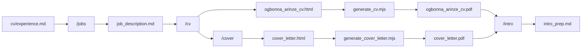

# Job Application Management System

A personal workflow for finding roles, researching companies, generating tailored CVs and cover letters, and preparing for interviews. Everything is grounded in verified work history so applications stay honest and consistent.

**Candidate:** Arinze Ogbonna  
**Email:** [arinzeogbo@gmail.com](mailto:arinzeogbo@gmail.com)  
**LinkedIn:** [https://linkedin.com/in/arinze-ogbonna](https://linkedin.com/in/arinze-ogbonna)

---

## Quick Start

```bash
# Install dependencies (Puppeteer for PDF generation)
npm install

# Typical workflow in Claude Code or Cursor:
/jobs Berlin
/cv jobs/09-04-2026/acme/job_description.md
/cover jobs/09-04-2026/acme/job_description.md
/intro jobs/09-04-2026/acme/job_description.md

```

---

## How It Works




1. **Discover** roles with `/jobs` and save structured briefings.
2. **Tailor** a CV with `/cv`, using real experience from source files.
3. **Write** a matching cover letter with `/cover`.
4. **Convert** HTML to PDF with per-job Puppeteer scripts.
5. **Prepare** for interviews with `/intro`.

---

## Project Structure

```
jobs/
  <DD-MM-YYYY>/              # Date the role was discovered
    <company_name>/          # Lowercase, underscores for spaces
      <job_title>/
        job_description.md   # Company intel, JD, application link
        salary_research.md   # Optional, created during /cv
        ogbonna_arinze_cv.html
        ogbonna_arinze_cv.pdf
        cover_letter.html
        cover_letter.pdf
        intro_prep.md        # Interview prep (from /intro)
        generate_cv.mjs
        generate_cover_letter.mjs

cv/
  experience.md              # Authoritative work history (source of truth)
  base_experience.md         # Skills inventory with "Where Used" columns
  base_cv.pdf                # Visual formatting reference only

.claude/
  commands/                  # Slash command definitions
    jobs.md
    cv.md
    cover.md
    intro.md
  skills/
    browser/                 # Browser automation for job research
```

Path rules for job folders:

- Use today's date in `DD-MM-YYYY` format.
- Lowercase company and title names.
- Replace spaces with underscores.
- Strip special characters.

Example: `jobs/09-04-2026/beroe_x_nnamu_gmbh/senior_frontend_software_engineer/`

---

## Source of Truth

All generated documents must trace back to these files. Never invent experience.


| File                    | Purpose                                                                |
| ----------------------- | ---------------------------------------------------------------------- |
| `cv/experience.md`      | Complete work history: companies, titles, dates, achievements, metrics |
| `cv/base_experience.md` | Verified skills with "Where Used" per role                             |
| `cv/base_cv.pdf`        | Layout and styling reference only (not a content source)               |


If a skill is not listed in `base_experience.md` for a given role, do not claim it there.

---

## Slash Commands

These live in `.claude/commands/` and are invoked in Claude Code or compatible AI assistants.

### `/jobs <location>`

Search for active frontend and fullstack roles in a given location.

- Focus: React, Next.js, Node, NestJS roles.
- Searches ATS platforms (Ashby, Lever, Greenhouse, Personio, Workday, and others).
- Creates `job_description.md` in a new job folder.
- Skips closed listings and duplicates (same company + similar title anywhere under `jobs/`).

**Example:** `/jobs Berlin`

Each `job_description.md` includes:

- Job title and company intelligence
- Direct application link
- Work model and location
- Role responsibilities and ideal candidate profile
- Application strategy notes

### `/cv [job_path]`

Generate a tailored CV for one job or all jobs missing a PDF.

- **With path:** process that folder only.  
Example: `/cv jobs/09-04-2026/pitch_software_gmbh/senior_frontend_engineer`
- **Without path:** scan `jobs/` for folders with `job_description.md` but no `ogbonna_arinze_cv.pdf`.

Outputs:

- `ogbonna_arinze_cv.html` (source)
- `ogbonna_arinze_cv.pdf` (after running `generate_cv.mjs`)
- `salary_research.md` (Glassdoor / fallback salary data)

The CV is tailored to the job description while following strict honesty rules (see below).

### `/cover [job_path]`

Generate a cover letter that **matches the tailored CV exactly**.

- Same target selection logic as `/cv`.
- Reads the existing CV in the job folder first to keep titles, dates, metrics, and claims identical.

Outputs:

- `cover_letter.html`
- `cover_letter.pdf` (after running `generate_cover_letter.mjs`)

### `/intro <job_path>` (required)

Prepare for a first-round interview. **Requires a job path.**

Example: `/intro jobs/17-03-2026/redcare_pharmacy/senior_fullstack_engineer`

Creates `intro_prep.md` with:

- Company deep dive and recent news
- Role analysis (must-haves vs nice-to-haves)
- Background alignment with talking points
- Scripted answers: "Tell me about yourself", "Why this company?", "What are you looking for?"
- Likely interview questions with bullet-point answers

---

## PDF Generation

HTML documents are converted to PDF with [Puppeteer](https://pptr.dev/). Each job folder gets its own scripts.

```bash
# Single job
node jobs/<date>/<company>/<title>/generate_cv.mjs
node jobs/<date>/<company>/<title>/generate_cover_letter.mjs
```

Settings used across scripts:

- Format: A4
- Font: Times New Roman, 10pt
- Margins: zero (padding handled in CSS)
- `printBackground: true`
- `preferCSSPageSize: true`

To regenerate PDFs after editing HTML, re-run the same script.

**Batch conversion:** run the generate scripts in each job folder, or loop over them:

```bash
find jobs -name "generate_cv.mjs" -exec node {} \;
find jobs -name "generate_cover_letter.mjs" -exec node {} \;
```

---

## Browser Skill

Located at `.claude/skills/browser/`. Used by AI agents for web research during job search, company deep dives, and salary lookups.

Requires the browse CLI:

```bash
which browse || npm install -g @browserbasehq/browse-cli
```


| Mode                     | When to use                          |
| ------------------------ | ------------------------------------ |
| **Local**                | Docs, public pages, localhost        |
| **Remote (Browserbase)** | CAPTCHAs, bot detection, login walls |


```bash
browse env local          # Isolated local Chrome
browse env remote         # Browserbase (needs BROWSERBASE_API_KEY)
browse open <url>
browse snapshot
```

See `.claude/skills/browser/SKILL.md` for full command reference.

---

## Honesty and Consistency Rules

These apply to every CV, cover letter, and interview prep document.

### Experience

- Career start: **Mar 2018** (valid claim: **8 years** of experience as of 2026).
- Every bullet must exist in `cv/experience.md`.
- Skills only where `base_experience.md` lists them for that role.

### Job Titles (exact)


| Company    | Correct title                                                             |
| ---------- | ------------------------------------------------------------------------- |
| Genentech  | Frontend Engineer                                                         |
| Descasio   | Senior Frontend Developer                                                 |
| OurNigeria | Senior Engineer (under **Projects**, not "Open Source" or "Side Project") |


### Other rules

- Python: personal projects only, no production Python/Django claims.
- OurNigeria: website only ([ournigeria.ng](https://ournigeria.ng)), no GitHub link.
- No em dashes in generated documents; use commas instead.
- CV and cover letter for the same job must use identical titles, dates, metrics, and claims.

---

## Dependencies

```json
{
  "puppeteer": "^24.38.0",
  "cheerio": "^1.2.0"
}
```

Install with `npm install`. Puppeteer downloads Chromium on first run.

Optional:

- `@browserbasehq/browse-cli` for browser automation skill
- `BROWSERBASE_API_KEY` in `.env` for remote browser sessions (`.env` is gitignored)

---

## Other Files


| File                       | Description                                                                        |
| -------------------------- | ---------------------------------------------------------------------------------- |
| `CLAUDE.md`                | Agent instructions for this repo (mirrors much of this README for AI context)      |
| `frontend_jobs_germany.md` | Curated list of verified frontend roles in Germany                                 |
| `fix_cvs.mjs`              | Utility to merge generated CV content into a base HTML template (legacy batch fix) |


---

## Typical Session

```text
1. /jobs Munich
   → New folders under jobs/09-04-2026/...

2. Review job_description.md files, pick roles to apply for

3. /cv jobs/09-04-2026/acme/senior_frontend_engineer
   → ogbonna_arinze_cv.html + salary_research.md

4. node jobs/09-04-2026/acme/senior_frontend_engineer/generate_cv.mjs
   → ogbonna_arinze_cv.pdf

5. /cover jobs/09-04-2026/acme/senior_frontend_engineer
   → cover_letter.html

6. node jobs/09-04-2026/acme/senior_frontend_engineer/generate_cover_letter.mjs
   → cover_letter.pdf

7. Submit application using files + link from job_description.md

8. /intro jobs/09-04-2026/acme/senior_frontend_engineer
   → intro_prep.md before the call
```

---

## Updating Your Profile

When your experience changes:

1. Edit `cv/experience.md` first (add roles, bullets, metrics, dates).
2. Update `cv/base_experience.md` with new skills and "Where Used" mappings.
3. Regenerate tailored documents for active applications with `/cv` and `/cover`.

Keeping the source files current is what makes every tailored application defensible in interviews.