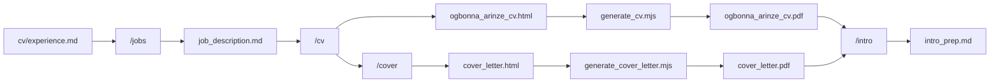

# Jobdesk: Job Search Dashboard

A private dashboard for Arinze's Germany and US job search. Includes recurring job discovery, source health, a daily goal, application tracking, and CV/cover-letter packs built from verified experience. The original CLI workflows and historical application files remain available below.

## Run the dashboard

Requires Node.js 24+, npm, and a running Docker Desktop.

```bash
npm install
npm run setup
npm run dev
```

Open **https://jobdesk.localhost**, or run `npm run dev:url` to print it. The hostname stays the same in linked worktrees; run one Jobdesk instance at a time. `setup` creates a local `.env`, starts isolated PostgreSQL/Redis containers, applies migrations, and imports the saved jobs. `dev` runs both the Next.js app and the scheduled-fetch worker through Portless, using its assigned app port. Conductor's Run action uses the same command.

Portless is installed as a project dev dependency and reuses the local proxy. On a new machine its initial HTTPS setup may require trusting its local certificate; see [Portless setup](https://github.com/vercel-labs/portless#http2--https). `npm run dev:direct` bypasses Portless and uses `PORT`, `CONDUCTOR_PORT`, or `55010`. PostgreSQL/Redis keep their workspace-specific ports. Set `TEST_BASE_URL` to the printed URL when running browser checks through Portless (and `NODE_EXTRA_CA_CERTS` to the Portless CA for Node HTTPS requests, if necessary).

1. Open **Discover jobs**. Filter by Germany/US, role track, remote work, or recently checked listings. You can also save a job from another board by pasting its description and application link.
2. Open a role and add it to the **Application queue**. Check its eligibility notes and original listing.
3. In **Application pack**, prepare and review the tailored CV and cover letter, then download the PDFs. Generation uses detailed evidence-based templates: summary, categorized competencies, all verified role achievements, role technologies, projects and education. Relevance changes ordering, while preserving the complete work history. The layout follows the original Times New Roman CV and allows additional pages for depth. No paid AI API calls are used.
4. Complete the employer's application in your browser. Record its confirmation and actual submission date in Jobdesk.
5. Track replies, interviews, notes, and follow-ups in **My applications**. Incorrect submission records can be corrected without losing their event history.
6. Set the goal and preferences in **Profile & preferences**; enable additional employer boards in **Job sources**.

The default daily target is 100. Its counter includes explicitly **self-reported confirmed submissions**, not document generation or opened links. Dates use Europe/Berlin. Historical job imports never imply historical applications.


## Events and hackathons across Europe

Open **Events & hackathons** in the dashboard. Live discovery covers Developers.events, Confs.tech, HackTrack EU, MLH, and eight European Luma city pages. Matching prioritizes AI/agents, web engineering, APIs/payments and developer tools, with a Germany preference. Filter by country, topic, event type, date and published free entry.

Shortlist events, export a calendar file, record registration/attendance, keep networking notes, and track people met and follow-ups. Opening the organizer page does not register you. Manually add events from other platforms using their published details.

The worker checks schedules every minute: Luma/HackTrack every 6 hours, MLH every 12 hours, and conference indexes daily. Intervals, pause/resume and refresh controls are in **Event sources**. Updates require the local worker to remain running. Luma provides a limited public-page selection; Meetup/Eventbrite and other unconnected platforms are explicitly identified. Unknown prices and student eligibility remain visible.

Run `npm run sync:events` for a one-off due-source fetch, or `npm run test:events:browser` for the event workflow browser check. See [event discovery coverage and implementation](docs/event-discovery.md).

## Sources and schedules

Adapters: Arbeitnow, Himalayas, Remotive, Greenhouse (global/EU), Lever (global/EU), Ashby, Personio (XML feed, or the public job list and pages when an employer has the feed switched off), Recruitee, SmartRecruiters, Teamtailor, Workable, and JOIN company pages. Fresh setups enable Arbeitnow (every four hours) and Himalayas (every six hours). Each Arbeitnow run reads every page of its Germany feed (about 90 pages, a few minutes, pausing between pages and waiting out rate limits); Himalayas runs eight role searches for Germany and one for the US. Backend, full-stack and platform roles whose description names only a non-Node backend (Java, Kotlin, Go, PHP, Ruby, .NET, Scala, Elixir) score at most 55 and say so in their match reasons. Employer boards found in the archive are initially available but disabled; enable those you want to follow. Remotive is optional and limited to twice daily because its public feed is delayed.

A BullMQ scheduler checks the database every minute. Sources have independent intervals, leases, run history, bounded pagination, and a retry delay that respects `Retry-After`. A failed or partial run never marks jobs closed. The dashboard shows worker freshness so a stopped worker is visible. Local schedules run only while the worker and Docker services are running; this is not yet an always-on hosted deployment.

Use `npm run sync` for one pass over due, enabled sources, `npm run import` to re-import saved files safely, or `npm run reindex` after matching-rule changes. `npm run import:boards` registers the employer boards listed in `content/sources/employer-boards.json` (employers from past application emails whose public feed was checked live); boards already present keep their settings. `npm run import:boards content/sources/discovered-boards.json` registers the boards found by probing public ATS feeds on 13 October 2026, each with at least one Germany software role at the time. The importer preserves discovery dates and reports files without usable links. Jobs are deduplicated by stable source listing identity and normalized application URL; fuzzy cross-board merging is not implemented.

## LinkedIn jobs

Two LinkedIn developer apps are configured in `.env`: **JobDesk** (Share on LinkedIn and Sign In with LinkedIn using OpenID Connect, `LINKEDIN_CLIENT_ID`/`LINKEDIN_CLIENT_SECRET`) and **JobDesk Data** (Member Data Portability API (Member), read-only, `LINKEDIN_DATA_CLIENT_ID`/`LINKEDIN_DATA_CLIENT_SECRET`). LinkedIn redirects only to the exact URL listed on each app's Auth tab, so their sign-in listeners always use fixed ports: `http://127.0.0.1:53682/callback` for JobDesk and `http://127.0.0.1:53683/callback` for JobDesk Data (`LINKEDIN_REDIRECT_URI`, `LINKEDIN_DATA_REDIRECT_URI`). If a port is busy, sign-in stops with an error instead of moving to another port.

LinkedIn forbids scraping its site, so LinkedIn jobs come from your own LinkedIn job alert and recommendation emails. The **LinkedIn job alert emails** source (every two hours) reads them read-only from the connected Gmail (`jobalerts-noreply@linkedin.com`, `jobs-noreply@linkedin.com`) and adds each listed job with its title, company and place. Each email lists about six jobs, so several focused alerts work better than one broad one.

A LinkedIn job links only to LinkedIn, and LinkedIn shows the employer's own application link only after sign-in. After each run Jobdesk looks for the company's public board (Greenhouse, Ashby, Lever, Personio, Recruitee, SmartRecruiters, Teamtailor, JOIN), registers it as a source, and merges the LinkedIn job into the board posting, which brings the full description and the direct application link. Up to 25 new companies are checked per run and each company is rechecked after 14 days; `npm run linkedin:resolve` works through a backlog. Jobs that stay LinkedIn-only say so in their match reasons ("open the posting on LinkedIn", or "Easy Apply"); Jobdesk never applies on LinkedIn. Postings by recruiters, staffing agencies and contractor marketplaces are labelled and score at most 30.

The earlier LinkedIn guest-search sources (`linkedin-berlin`, `-munich`, `-hamburg`, `-germany`) are switched off; their jobs stay in the dashboard.

## Mail updates

Jobdesk can read arinzeogbo@gmail.com (read-only) and keep application cards current: receipt confirmed, assessment set, interview invited, offer, rejected. A card changes on its own only when two independent readers agree on what an email says: the English and German rules, and Claude. Everything else waits in **Needs review** on the applications page with both readings shown. Every automatic change is logged on the card's timeline with the email as evidence and an Undo. Mail that asks you to do something appears under **Action needed** on the overview with its deadline. Design: [mail pipeline](docs/superpowers/specs/2026-10-13-mail-pipeline-design.md).

One-time setup:

1. In [Google Cloud Console](https://console.cloud.google.com/), create a project and enable the **Gmail API**.
2. Configure the OAuth consent screen as **External**, add your own address, and set the publishing status to **In production**. Left in "Testing", Google expires the sign-in every 7 days. Google shows an "unverified app" warning at sign-in; that is expected for a personal project.
3. Create an OAuth client of type **Desktop app** and put its values in `.env` as `GOOGLE_CLIENT_ID` and `GOOGLE_CLIENT_SECRET`.
4. Add `ANTHROPIC_API_KEY` to `.env`. Without it nothing is applied automatically except receipts; every outcome email waits in Needs review.
5. Run `npm run mail:connect` and approve read-only access. The sign-in token is stored in `.data/gmail-token.json`, outside git and outside the database.

Switching it on:

1. `npm run mail:backfill` reads mail since 1 September 2025 and writes `.context/mail-backfill-report.md`. It changes no card. Running it again starts over with the current rules; `-- --resume` continues a run that was cut short; `-- --discard` throws the proposals away.
2. Read the report. It lists every card that would be created or changed, every proposed rejection with the sentence it rests on, and what would wait for review.
3. `npm run mail:backfill -- --apply` applies the proposals and turns scheduled checks on. Add `--hold=<mail id>,<mail id>` to send individual proposals to Needs review instead. Anything that no longer matches the report (because the board changed in between) also goes to review.

Until step 3 has completed, nothing changes a card: the worker and `npm run mail:sync` do nothing. Afterwards the worker checks every 10 minutes while it is running. `npm run mail:sync` runs one check by hand (`-- --retry` retries emails that could not be loaded), `npm run mail:reclassify` re-reads mail that is undecided or waiting for review, and `npm run mail:backfill -- --off` turns scheduled checks off again.

What to know:

- Jobdesk cannot send, delete, label or mark mail as read, and it does not read Spam.
- Mail bodies are stored only in the local database. Receipts, data notices and unrelated mail never leave your machine. Sent to the Claude API: mail the rules cannot classify, mail the rules read as a rejection, assessment, interview, offer or recruiter question (for the second reading), and receipts that would create a card or mark a prepared card as submitted. Set `MAIL_SECOND_OPINION=off` to stop the second reading; those emails then wait in Needs review.
- The sender has to confirm the company: an email that merely names a company on your board, from an address that is neither a hiring system nor that employer, never changes a card.
- If a company has one card but the email names a different role, or the email is older than the application, it goes to review.
- Cards created from an email (applications Jobdesk did not submit) are tagged "From email" and do not count toward the daily goal.
- Only the latest change on a card can be undone. An email attached to the wrong card can be unlinked from the card's timeline.
- Replying, booking interview slots and push notifications are not included.

## Interview preparation

Each interview is its own record on an application: stage, time (in your time zone and the interviewer's), interviewers, and the meeting, event and reschedule links. Interviews are added automatically from confirmation emails (Recruitee, Calendly, Google Calendar invitations, Greenhouse, Ashby, Lever, GoodTime and calendar attachments) when the email matches one card and the sender confirms the company; others appear in Needs review with "Add as interview". You can also add one from the card's Notes & history tab. The card's next step becomes the interview time. Design: [interview preparation](docs/superpowers/specs/2026-10-19-interview-prep-design.md).

Upcoming interviews show on the overview with a countdown. Each interview page has:

- **Details:** editable time, interviewers and links.
- **Prep sheet:** "Generate prep" researches the company with the Claude API's web search and writes a sheet from the job description, your application notes, the interview emails and `cv/experience.md` / `cv/base_experience.md`, tailored to the stage. Before saving, code checks it: evidence whose quote is not in your experience files, wrong job titles and company facts without a source are removed, and numbers your files do not contain are flagged. An `intro_prep.md` in the job folder is shown too.
- **Questions:** likely questions with answer outlines and evidence, your own notes, and a Ready toggle. Regenerating the sheet keeps your notes.
- **Practice:** a spoken mock interview. Claude plays that stage's interviewer; Chrome speaks each question and transcribes your answer (you can edit it, or type instead in other browsers). Feedback covers structure, specificity, evidence, length, pace, filler words and claims your files do not support, and ends with three things to improve. Sessions are saved locally; no audio is recorded.
- **After the call:** debrief, next steps (which become the card's next step) and a thank-you email draft to copy. Jobdesk never sends email.

`npm run interviews:from-mail` adds interviews from confirmation emails that were stored before this feature existed (`-- --dry-run` shows them first). Generated prep sends the job description, application notes, interview emails and your experience files to the Claude API; practice sends transcripts, and Chrome sends your voice to Google's speech service while you speak. `PREP_AI_MODEL` (default `claude-opus-5-5`) and `PRACTICE_AI_MODEL` choose the models.

## Development and checks

```bash
npm run typecheck
npm test
npm run test:integration  # Uses and cleans up synthetic records in the local database
npm run test:browser      # Run npm run dev first; uses synthetic local records only
npm run build
```

Browser checks cover search, queueing, PDF generation, approval, submission recording, outcomes, source controls, and mobile layout. Screenshots and a test PDF are saved in `.context/`. No tests submit applications to employers.

For a local production build, run `npm run build`, then `npm start -- --port 55010` and `npm run worker` in separate terminals. Stop the dev process before starting another server on that port.

## Storage and access

- PostgreSQL holds jobs, source runs, versioned document HTML/evidence references, preferences, and application events. Docker named volumes retain data across restarts. `docker compose down` stops services without deleting those volumes.
- CV downloads use `Company_Candidate_Position.pdf`; cover letters use the same base with `_Cover_Letter.pdf`. Spaces and unsafe filename characters become underscores. PDF downloads are rendered on demand with Puppeteer. Set `CHROME_EXECUTABLE_PATH` if you prefer an existing Chrome installation.
- Your career facts remain in `cv/experience.md` and `cv/base_experience.md`; CV/letter contact details live in `cv/contact.json`. Profile, job and template changes invalidate unsubmitted document approvals; submitted packs are preserved. Refresh an older application pack to generate the detailed CV, then review the new version.
- The server binds to loopback by default. Set `DASHBOARD_PASSWORD` to enable HTTP Basic authentication (username `arinze`). Do not expose this personal dashboard publicly without authentication and HTTPS. Local Docker credentials in `compose.yaml` are development-only.
- Export application history from **My applications**. To back up the full database: `docker compose exec -T postgres pg_dump -U jobdesk jobdesk > jobdesk-backup.sql`. Store backups outside the repository; they contain personal data.

This first version uses transparent stack-overlap ranking. Work authorization is never inferred. Salary/language/work-model preferences are saved for review; only the explicit country, role, and remote filters narrow results. Cross-board fuzzy dedupe, automatic closure checks, LLM rewriting, DOCX, browser autofill, and unattended submission remain future work. See [the roadmap](docs/job-dashboard-plan.md).

---

## Original CLI workflow

A personal workflow for finding roles, researching companies, generating tailored CVs and cover letters, and preparing for interviews. Everything is grounded in verified work history so applications stay honest and consistent.

**Candidate:** Arinze Ogbonna  
**Email:** [arinzeogbo@gmail.com](mailto:arinzeogbo@gmail.com)  
**LinkedIn:** [https://linkedin.com/in/arinze-ogbonna](https://linkedin.com/in/arinze-ogbonna)

---

## Quick Start

```bash
# Install dependencies (Puppeteer for PDF generation)
npm install

# Typical workflow in Claude Code or Cursor:
/jobs Berlin
/cv jobs/09-04-2026/acme/job_description.md
/cover jobs/09-04-2026/acme/job_description.md
/intro jobs/09-04-2026/acme/job_description.md

```

---

## How It Works




1. **Discover** roles with `/jobs` and save structured briefings.
2. **Tailor** a CV with `/cv`, using real experience from source files.
3. **Write** a matching cover letter with `/cover`.
4. **Convert** HTML to PDF with per-job Puppeteer scripts.
5. **Prepare** for interviews with `/intro`.

---

## Project Structure

```
jobs/
  <DD-MM-YYYY>/              # Date the role was discovered
    <company_name>/          # Lowercase, underscores for spaces
      <job_title>/
        job_description.md   # Company intel, JD, application link
        salary_research.md   # Optional, created during /cv
        ogbonna_arinze_cv.html
        ogbonna_arinze_cv.pdf
        cover_letter.html
        cover_letter.pdf
        intro_prep.md        # Interview prep (from /intro)
        generate_cv.mjs
        generate_cover_letter.mjs

cv/
  experience.md              # Authoritative work history (source of truth)
  base_experience.md         # Skills inventory with "Where Used" columns
  base_cv.pdf                # Visual formatting reference only

.claude/
  commands/                  # Slash command definitions
    jobs.md
    cv.md
    cover.md
    intro.md
  skills/
    browser/                 # Browser automation for job research
```

Path rules for job folders:

- Use today's date in `DD-MM-YYYY` format.
- Lowercase company and title names.
- Replace spaces with underscores.
- Strip special characters.

Example: `jobs/09-04-2026/beroe_x_nnamu_gmbh/senior_frontend_software_engineer/`

---

## Source of Truth

All generated documents must trace back to these files. Never invent experience.


| File                    | Purpose                                                                |
| ----------------------- | ---------------------------------------------------------------------- |
| `cv/experience.md`      | Complete work history: companies, titles, dates, achievements, metrics |
| `cv/base_experience.md` | Verified skills with "Where Used" per role                             |
| `cv/base_cv.pdf`        | Layout and styling reference only (not a content source)               |


If a skill is not listed in `base_experience.md` for a given role, do not claim it there.

---

## Slash Commands

These live in `.claude/commands/` and are invoked in Claude Code or compatible AI assistants.

### `/jobs <location>`

Search for active frontend and fullstack roles in a given location.

- Focus: React, Next.js, Node, NestJS roles.
- Searches ATS platforms (Ashby, Lever, Greenhouse, Personio, Workday, and others).
- Creates `job_description.md` in a new job folder.
- Skips closed listings and duplicates (same company + similar title anywhere under `jobs/`).

**Example:** `/jobs Berlin`

Each `job_description.md` includes:

- Job title and company intelligence
- Direct application link
- Work model and location
- Role responsibilities and ideal candidate profile
- Application strategy notes

### `/cv [job_path]`

Generate a tailored CV for one job or all jobs missing a PDF.

- **With path:** process that folder only.  
Example: `/cv jobs/09-04-2026/pitch_software_gmbh/senior_frontend_engineer`
- **Without path:** scan `jobs/` for folders with `job_description.md` but no `ogbonna_arinze_cv.pdf`.

Outputs:

- `ogbonna_arinze_cv.html` (source)
- `ogbonna_arinze_cv.pdf` (after running `generate_cv.mjs`)
- `salary_research.md` (Glassdoor / fallback salary data)

The CV is tailored to the job description while following strict honesty rules (see below).

### `/cover [job_path]`

Generate a cover letter that **matches the tailored CV exactly**.

- Same target selection logic as `/cv`.
- Reads the existing CV in the job folder first to keep titles, dates, metrics, and claims identical.

Outputs:

- `cover_letter.html`
- `cover_letter.pdf` (after running `generate_cover_letter.mjs`)

### `/intro <job_path>` (required)

Prepare for a first-round interview. **Requires a job path.**

Example: `/intro jobs/17-03-2026/redcare_pharmacy/senior_fullstack_engineer`

Creates `intro_prep.md` with:

- Company deep dive and recent news
- Role analysis (must-haves vs nice-to-haves)
- Background alignment with talking points
- Scripted answers: "Tell me about yourself", "Why this company?", "What are you looking for?"
- Likely interview questions with bullet-point answers

---

## PDF Generation

HTML documents are converted to PDF with [Puppeteer](https://pptr.dev/). Each job folder gets its own scripts.

```bash
# Single job
node jobs/<date>/<company>/<title>/generate_cv.mjs
node jobs/<date>/<company>/<title>/generate_cover_letter.mjs
```

Settings used across scripts:

- Format: A4
- Font: Times New Roman, 10pt
- Margins: zero (padding handled in CSS)
- `printBackground: true`
- `preferCSSPageSize: true`

To regenerate PDFs after editing HTML, re-run the same script.

**Batch conversion:** run the generate scripts in each job folder, or loop over them:

```bash
find jobs -name "generate_cv.mjs" -exec node {} \;
find jobs -name "generate_cover_letter.mjs" -exec node {} \;
```

---

## Browser Skill

Located at `.claude/skills/browser/`. Used by AI agents for web research during job search, company deep dives, and salary lookups.

Requires the browse CLI:

```bash
which browse || npm install -g @browserbasehq/browse-cli
```


| Mode                     | When to use                          |
| ------------------------ | ------------------------------------ |
| **Local**                | Docs, public pages, localhost        |
| **Remote (Browserbase)** | CAPTCHAs, bot detection, login walls |


```bash
browse env local          # Isolated local Chrome
browse env remote         # Browserbase (needs BROWSERBASE_API_KEY)
browse open <url>
browse snapshot
```

See `.claude/skills/browser/SKILL.md` for full command reference.

---

## Honesty and Consistency Rules

These apply to every CV, cover letter, and interview prep document.

### Experience

- Career start: **Mar 2018** (valid claim: **8 years** of experience as of 2026).
- Every bullet must exist in `cv/experience.md`.
- Skills only where `base_experience.md` lists them for that role.

### Job Titles (exact)


| Company    | Correct title                                                             |
| ---------- | ------------------------------------------------------------------------- |
| Genentech  | Frontend Engineer                                                         |
| Descasio   | Senior Frontend Developer                                                 |
| OurNigeria | Senior Engineer (under **Projects**, not "Open Source" or "Side Project") |


### Other rules

- Python: professional use only at Genentech (RAG pipeline and backend for the chat widget); otherwise personal projects. No years-of-Python, Django, FastAPI, or model-training claims.
- OurNigeria: website only ([ournigeria.ng](https://ournigeria.ng)), no GitHub link.
- No em dashes in generated documents; use commas instead.
- CV and cover letter for the same job must use identical titles, dates, metrics, and claims.

---

## Dependencies

```json
{
  "puppeteer": "^24.38.0",
  "cheerio": "^1.2.0"
}
```

Install with `npm install`. Puppeteer downloads Chromium on first run.

Optional:

- `@browserbasehq/browse-cli` for browser automation skill
- `BROWSERBASE_API_KEY` in `.env` for remote browser sessions (`.env` is gitignored)

---

## Other Files


| File                       | Description                                                                        |
| -------------------------- | ---------------------------------------------------------------------------------- |
| `CLAUDE.md`                | Agent instructions for this repo (mirrors much of this README for AI context)      |
| `frontend_jobs_germany.md` | Curated list of verified frontend roles in Germany                                 |
| `fix_cvs.mjs`              | Utility to merge generated CV content into a base HTML template (legacy batch fix) |


---

## Typical Session

```text
1. /jobs Munich
   → New folders under jobs/09-04-2026/...

2. Review job_description.md files, pick roles to apply for

3. /cv jobs/09-04-2026/acme/senior_frontend_engineer
   → ogbonna_arinze_cv.html + salary_research.md

4. node jobs/09-04-2026/acme/senior_frontend_engineer/generate_cv.mjs
   → ogbonna_arinze_cv.pdf

5. /cover jobs/09-04-2026/acme/senior_frontend_engineer
   → cover_letter.html

6. node jobs/09-04-2026/acme/senior_frontend_engineer/generate_cover_letter.mjs
   → cover_letter.pdf

7. Submit application using files + link from job_description.md

8. /intro jobs/09-04-2026/acme/senior_frontend_engineer
   → intro_prep.md before the call
```

---

## Updating Your Profile

When your experience changes:

1. Edit `cv/experience.md` first (add roles, bullets, metrics, dates).
2. Update `cv/base_experience.md` with new skills and "Where Used" mappings.
3. Regenerate tailored documents for active applications with `/cv` and `/cover`.

Keeping the source files current is what makes every tailored application defensible in interviews.

## Referral discovery

Every job has a **Referrals** tab for public company-page contact discovery, LinkedIn profile imports, evidence-based message drafts and follow-up tracking. Engineers and engineering managers rank first, then recruiters. No paid provider account is required. See [referral workflow and coverage](docs/referrals.md).
