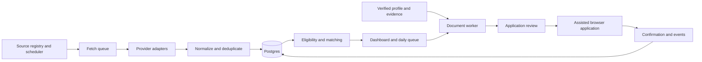

# Germany and US job application dashboard

Roadmap drafted 5 October 2026. The first local implementation is now present. The detailed sections below describe the broader target; see the implementation status for what currently works.

## Implementation status

Implemented: private local Next.js dashboard; PostgreSQL/Prisma storage and migrations; Redis/BullMQ scheduler; twelve source adapters; idempotent historical import and employer-board discovery; explicit location/remote/role/search filters; transparent stack-overlap ranking; manual job capture; application queue, notes, follow-ups, outcomes, and JSON export; evidence-selected CV/cover-letter templates with PDF downloads and approval; daily self-reported submission counting and history using Berlin dates; source health; persisted profile preferences; desktop/mobile UI; domain, integration, and browser tests. The Conductor run script starts web and worker together.

This workspace has live source schedules enabled. No paid provider account has been activated, and no application has been submitted to an employer by the dashboard or its tests. Work-authorization answers remain unknown until reviewed by the user.

Remaining: always-on hosting, licensed aggregators such as Adzuna, fuzzy cross-board merging, authoritative closure reconciliation, incremental cursors beyond bounded discovery scans, richer eligibility extraction, weighted matching beyond initial stack overlap, LLM-assisted rewriting and DOCX, browser autofill/submission adapters, richer cohort analytics, and the seven-day throughput pilot. Current generation is deterministic evidence selection, not an LLM call; current progress is user-attested; since 13 October 2026 a read-only Gmail connection can attach employer receipts and move cards on replies ([design](superpowers/specs/2026-10-13-mail-pipeline-design.md)), once the user has connected it. Current pagination is offset-based with stable sort order rather than the proposed cursor pagination.

## Product objective

Build a private dashboard that finds relevant Germany and US opportunities, explains their fit, prepares truthful application documents, helps submit applications, and measures confirmed applications and interview outcomes. Daily application target: 100, configurable by working day.

Broad coverage is an ongoing connector program, not a promise to index every job board. Fresh eligible job supply and actual form-completion time determine whether 100 applications per day is sustainable. The product should expose these constraints early.

## Evidence reviewed

- Inventoried 119 local Conductor workspace directories across 20 repository groups using available root/application manifests and README files. This was a portfolio inventory, not a complete code or authorship audit. Several workspaces contained no project files outside hidden directories.
- Reviewed this repository's README, CLAUDE.md, authoritative `cv/experience.md`, verified `cv/base_experience.md`, and job-search command.
- Found 306 saved `job_description.md` files. These are discoveries, not evidence of 306 submitted applications.
- OurNigeria / `spending`: verified profile describes NestJS, Next.js, PostgreSQL, hybrid RAG, Mastra, ingestion, streaming, and observability; manifests corroborate substantial relevant tooling.
- `turtleridgehomes` and `watson-team-sites`: documentation/manifests show LangGraph concierge, Postgres, external data integrations, and Cloudflare deployments. Inspected scheduled workflow code in `watson-team-sites/medan/apps/turtleridgehomes-cron/src/index.ts`.
- `flairtap`: documentation/manifests show Next.js, Prisma, BullMQ, Redis, authentication, and publishing workflows.
- `install-to-grid`: inspected agent orchestration and approval checkpoints. Its outbound submission is explicitly mocked; it must not be described as a production external integration.
- `emma-wine`: Expo/React Native catalogue UI, explicitly using mock data in the reviewed README. Potential secondary portfolio evidence, not established production mobile experience.
- Other evidence includes an Eleventy event site and WordPress development workflow. A checkout of another author's project, such as Clicky, establishes neither authorship nor contribution.

The local inventory is in `.context/workspace-inventory.json`. New portfolio claims need contribution, maturity, dates, and shareability confirmed before incorporation into the authoritative profile.

Profile update confirmed by the user on 5 October 2026: Genentech ended in January 2026. Updated `cv/experience.md` and the CV command's date reference to May 2023–January 2026. Historical generated application documents remain snapshots of their original preparation.

The user also confirmed **Wunderflats — Senior Software Engineer, April–September 2026 (start month corrected on 6 October 2026)**. The company spelling was corrected from "Wundeflats" to "Wunderflats" by the user on 13 October 2026; documents submitted before that date carry the old spelling. Recorded codebase maintenance/refactoring, CI/CD restructuring with an estimated 30% reduction in pipeline wait time, Stripe Connect payment work, Google One Tap login to improve retention, and removal of dead-end screens/navigation improvements to improve booking rates. On 6 October 2026, the user also confirmed reducing/removing unnecessary test runs as part of the CI/CD improvement, leading customer-focused discussions about user experience, and building an AI agent running asynchronously on Google Cloud Run. The agent takes Jira tickets through microservice/blast-radius triage, Google Cloud log investigation, bug reproduction, a proposed fix, pull request creation, and Jira updates. For smaller production bugs, the user reports a reduction from roughly two days to minutes to produce a proposed fix; do not imply automatic merging or deployment. The profile and skill inventory contain these facts. Retention and booking outcomes remain qualitative. Languages, frameworks, CI/CD provider, employment type, and location remain unconfirmed; do not infer them or attribute another role's achievements to this position.

## Search tracks and matching

| Track | Search terms | Evidence / constraints |
| --- | --- | --- |
| Senior frontend | Frontend Engineer, React Developer, UI Engineer, Design Systems Engineer | Strong verified React/TypeScript, performance, accessibility, testing experience |
| Full-stack / product | Full Stack Engineer, Product Engineer, Next.js Engineer, Software Engineer | Node.js, React/Next.js, product ownership, integrations |
| Backend | Backend Engineer, Node.js Engineer, NestJS Engineer | Target TypeScript, APIs, ingestion, Postgres; avoid assuming equivalent Java/Go experience |
| Applied AI | AI Engineer, LLM Engineer, RAG Engineer, AI Product Engineer | Verified RAG, retrieval, orchestration, evaluation, streaming; distinguish from model-training/research roles |
| Agent automation | AI Automation Engineer, Agent Engineer, AI Solutions Engineer, Developer Tools Engineer | Tool use, workflow orchestration, browser automation, integrations; new MCP claims require evidence |

Include German title variants such as Softwareentwickler, Frontend-Entwickler, Fullstack-Entwickler, and KI-Entwickler. Search title and description. Do not require every listing to use a fashionable “AI Engineer” title.

First evaluate eligibility: workplace country, permitted remote countries, relocation, work authorization/sponsorship requirements, language requirements, employment type, and user-defined exclusions. Use `eligible`, `ineligible`, and `unknown`; unknown requires review rather than optimistic inference. “Remote US” does not mean remote from Germany. Company headquarters and permitted worker location are separate fields.

Rank remaining jobs with an explainable initial score: 40% evidenced skills, 25% responsibilities, 15% seniority, 10% preferences, 10% freshness. These are proposed weights, not a probability of an offer. Missing salary or eligibility data stays explicitly unknown. Each match should show evidence, missing requirements, and data confidence. Run cheap rules before model extraction; cache by description hash and profile version. Add embeddings only if measured matching quality warrants them.

## Sources and access

Intervals below are proposed starting policies, subject to the provider's current terms, quotas, and response headers. Listing access never implies application-submission permission.

| Source | Method and role | Proposed refresh |
| --- | --- | --- |
| Greenhouse | Public job-board GET API, one known employer board at a time; confirm regional host. Submission API requires employer credentials. [Documentation](https://docs.greenhouse.io/job-board.html) | 30–60 minutes for priority boards; 6–12 hours for long tail |
| Lever | Employer-scoped postings API, global/EU instances, pagination and hosted apply URL. POST requires employer API key and does not expose all custom questions. [Documentation](https://github.com/lever/postings-api) | 30–60 minutes priority; 6–12 hours long tail |
| Ashby | Employer-scoped published postings feed; optional compensation and application URLs. [Documentation](https://developers.ashbyhq.com/docs/public-job-posting-api) | 30–60 minutes priority; 6–12 hours long tail |
| Personio | Employer-enabled XML feed, including English/German variants. [Documentation](https://developer.personio.de/v1.0/reference/get_xml) | 2–4 hours |
| Arbeitnow | Public API with Germany/Europe coverage, remote flag, and documented sponsorship filter. [Provider description](https://www.arbeitnow.com/blog/job-board-api) | 2–4 hours, rate limits permitting |
| Himalayas | Public remote-job search/feed, country and timezone restrictions; preserve required attribution. Feed uses cursors and max 20 records per request. [Documentation](https://himalayas.app/api) | 4–6 hours, bounded pagination |
| Remotive | Public remote feed, with 24-hour publication delay and attribution requirements. [Documentation](https://github.com/remotive-com/remote-jobs-api) | Twice daily; no benefit from minute polling |
| Adzuna | Credentialed country/keyword search, proposed DE and US queries; validate account coverage, quota, retention, and display terms in connector spike. [Overview](https://developer.adzuna.com/overview), [search](https://developer.adzuna.com/docs/search) | Quota-budgeted daily batches initially; increase only within account allowance |
| Recruitee, SmartRecruiters, Teamtailor, Workable | Implemented 13 October 2026 from public feeds: Recruitee offers JSON, SmartRecruiters postings API (detail request only for engineering titles), Teamtailor jobs RSS, Workable widget JSON (throttles quickly, keep few boards) | 6 hours |
| JOIN | Implemented 13 October 2026 from public company and job pages (robots.txt permits them); page data only, so a layout change surfaces as a failed run | 6 hours |
| Other ATS / direct careers | Workday is an expansion candidate; verify each supported feed or permitted page access first | 6–24 hours after validation |
| LinkedIn, Indeed, StepStone, Wellfound, BA Jobsuche, specialist boards | Saved links, user-provided alert imports, employer-page resolution, or approved licensed/partner access. Do not assume unrestricted search APIs | Event-driven imports; licensed polling only if available |

LinkedIn explicitly disallows third-party scraping/automation on its site: [policy](https://www.linkedin.com/help/linkedin/answer/a1340567/automated-activity-on-linkedin?lang=en). Indeed documents partner integrations and approved uses: [documentation](https://docs-plus.indeed.com/). StepStone's documented job-feed integration is contractual: [feed documentation](https://api.stepstone.com/wp-content/uploads/2025/03/Stepstone_JobFeed_DE.pdf). None of these is a confirmed unrestricted personal aggregation feed.

Employer-scoped feeds need a discovery layer. Seed a company/board registry from the 306 existing job files, then expand through targeted search, company career links, aggregator destinations where allowed, and pasted URLs. Record discovery provenance, country, ATS, board identifier, and last validation. Begin with roughly 100–300 verified relevant companies; measure incremental eligible jobs before expanding. This is a target registry size, not observed coverage.

## Ingestion, cron, and reliability

Recommended initial architecture: Next.js/TypeScript dashboard and API, Postgres with Prisma, Redis/BullMQ background workers, and private object storage for documents. Use a small always-on container host for the scheduler and workers, separate from browser requests. A sleeping Mac cannot provide continuous ingestion. Keep PDF/browser execution in its own resource-limited Node worker.

This matches existing portfolio tools and avoids making a separate backend framework necessary in v1. Hosting provider and paid data services remain undecided pending budget. A Cloudflare implementation could also work, but choose one orchestration stack for the first release.

Use a one-minute BullMQ Job Scheduler tick to select due source partitions using `next_run_at`. Scheduling behavior and idempotent jobs are covered in the [scheduler docs](https://docs.bullmq.io/guide/job-schedulers/) and [idempotency guidance](https://docs.bullmq.io/patterns/idempotent-jobs). The tick enqueues short work; it never crawls all boards itself.

Each source run:

1. Atomically claim a source lease; create a run ID and expiry so crashed workers can recover.
2. Apply per-host concurrency/rate limits, jitter, request/page budgets, and timeouts.
3. Fetch pages with checkpointed cursors, overlapping date windows where supported, and conditional requests where supported.
4. Validate raw records, keep permitted snapshots, sanitize descriptions, normalize fields, and upsert source listings.
5. Deduplicate canonical jobs, then enqueue extraction/matching only for new or materially changed descriptions.
6. Record complete/partial/failed status, freshness, counts, errors, and next run. Persist an outbox so committed changes cannot lose downstream work if queue dispatch fails.

Maintain unique `(source, board, external_id)` listings. Associate them with a canonical vacancy using stable ATS requisition/application identity first, then normalized company, title, location, and description evidence. Ambiguous duplicates get grouped for review; do not collapse distinct requisitions solely because their titles match. Preserve all source links and required attribution. Language variants and reposts should not automatically create new application opportunities.

Retry fetch/extraction failures with exponential backoff and jitter, respecting `Retry-After`. Quarantine malformed records; pause repeatedly failing connectors and surface them on Sources. A connector outage must not stop other sources.

Track employer `published_at`, `first_seen_at`, `last_seen_at`, `last_checked_at`, and `closed_at` separately. An aggregator refresh or local discovery timestamp is not a new posting date. Only infer closure from an explicit closure or repeated absence from a complete authoritative employer feed, for example two successful full runs at least 24 hours apart. Missing from a search result is insufficient. Partial runs, capped pagination, expired cursors, and errors never close jobs. Recheck shortlisted vacancies before applying.

Schedule daily company discovery, stale-job rechecks, and metrics reconciliation independently. Prepare the daily queue around 07:00 Europe/Berlin with daylight-saving-aware local scheduling; ingestion timestamps remain UTC. After downtime, claim overdue sources and rebuild the queue without replaying every missed tick.

## Dashboard and rendering

Six main views:

1. **Today:** confirmed applications / 100, ready queue, blockers, remaining estimated time, follow-ups, and a resumable “Start session” action.
2. **Discover:** searchable table/list with country, remote eligibility, title, company, salary/currency, fit reasons, posted/discovered date, freshness, source, and application status. Saved filters for the five role tracks.
3. **Job detail:** split view with sanitized original description, evidence-backed fit/gaps, employer link, document previews, application questions, and prior company applications.
4. **Apply:** next queued job, selected documents, reusable answers, unusual questions, and assisted form completion. Keyboard shortcuts for queue/skip/open and automatic advance after confirmed submission.
5. **Pipeline and analytics:** applications, replies, interviews, offers, rejections, withdrawals, and follow-up dates.
6. **Profile and Sources:** verified evidence, reusable answers, connector coverage/freshness/failures, and usage budgets.

Render from Postgres, not from live board calls on page load. Use server-side filters, indexed queries, stable cursor pagination, a desktop dense list and mobile cards. Preserve filters in the URL. Poll background status initially; introduce SSE only if useful. Show explicit empty, loading, failed-source, stale-data, and no-eligible-jobs states. Never embed unsanitized source HTML or arbitrary scripts.

## CV, cover letter, and application workflow

Convert current Markdown into a versioned profile with immutable evidence IDs; retain the Markdown as the authoritative import/export format. Keep employment history separate from project evidence. A code dependency alone is not evidence of professional proficiency or personal authorship.

Prepare five reviewed CV bases aligned to the five search tracks. For each shortlisted job:

1. Snapshot the job description and requirements.
2. Select relevant verified achievements; generate structured CV content and a concise cover letter when requested or useful. Generate specific screening answers too.
3. Validate every claim against its evidence, exact titles/dates/metrics, and allowed role-to-skill mappings. Flag unsupported requirements as gaps. Keep Python claims within the confirmed scope: professional use at Genentech for the RAG pipeline and backend only (confirmed 13 October 2026); no years-of-Python, Django, FastAPI, or model-training claims.
4. Render PDF using a shared Puppeteer template, building on existing HTML/PDF work. Support DOCX if a form requires it. Test text extraction, overflow, reading order, and file-size limits; never turn the CV into an image.
5. Show changes from the approved base, preview the documents, and pin the approved profile/document/job versions to the application.

CV and letter derive from the same structured facts. Model output cannot silently overwrite work history. Cache on `(job_description_hash, profile_version, template_version, prompt_version)`; profile changes invalidate unsubmitted packs. Save previous submitted versions intact.

Maintain reusable factual answers: contact details, links, location, notice period, compensation preferences, and user-confirmed authorization/sponsorship answers. Unknown facts, sensitive demographic questions, and attestations need explicit user input; never invent them. Treat job descriptions as untrusted data, not instructions to the generator or browser.

Application automation should progress in layers:

- V1: application pack, one-click open employer form, copy answers, download correct attachments, and explicit manual submission recording.
- V2: local browser extension/companion uses the user's existing browser session on supported employer forms to fill fields and attach the selected documents. Show unanswered/custom questions and wait for final review. Keep login/session material local.
- Later: tightly scoped, explicitly authorized submission automation for validated supported flows; no universal unattended auto-apply promise. CAPTCHA, login, unexpected questions, and changed forms pause the flow.

Document preparation can run in parallel; applications should follow the user's review pace. Confirmed application requires a receipt/confirmation-page signal or explicit user attestation, with the evidence type visible. Clicking Submit or opening a link does not count. If a request times out after submit, use `submission_unknown`; reconcile before retrying to avoid duplicates.

## Making 100 applications per day measurable

The target is 100 distinct confirmed applications per selected local working day. Keep `prepared`, `attempted`, `confirmed`, `self_reported`, and `unknown` visible separately. Define whether the main counter includes self-reported submissions, and display that breakdown. Deduplicate by candidate and canonical vacancy; company-level warnings catch related postings.

Time arithmetic, excluding discovery/preparation/review overhead:

| Average active form time | Time for 100 |
| --- | --- |
| 2 minutes | 3 hours 20 minutes |
| 3 minutes | 5 hours |
| 5 minutes | 8 hours 20 minutes |

Build a queue of around 120 eligible, reviewed candidates where supply allows, giving room for closures and form blockers. That buffer is an operating target, not guaranteed inventory. Offer four sessions of 25, resume incomplete sessions, and show estimated remaining time using observed duration by ATS. Keep high-fit complex applications in a dedicated queue so speed does not crowd them out.

Seven-day pilot: measure new eligible unique jobs/day, confirmed submissions/hour, blocker rate, time spent reviewing, and cost/application. If the market supplies 60 suitable new jobs/day while 100/day are submitted, backlog shrinks by 40/day; a 400-job backlog lasts ten days. Show runway and shortages honestly. Do not fill the quota by relaxing eligibility or duplicating submissions invisibly.

Analytics:

- Daily/weekly target completion and rolling averages, using Europe/Berlin local dates and DST-aware boundaries.
- Funnel: discovered → eligible → queued → prepared → submitted → response → interview → offer.
- Positive reply/interview rates by source, role track, country, CV version, and submission cohort.
- Active minutes per application, blocker reasons, source freshness, unique eligible yield, and cost per confirmed application.
- Follow-ups due and unanswered applications, without automatically treating silence as rejection.

Use distinct application IDs, immutable stage events, actual submission timestamps, reversible manual corrections, and documented metric denominators. Imported historical applications without known dates should not count as submitted today. Compare 14/30-day cohorts only after enough follow-up time; tiny samples should not drive automatic CV or source changes.

## Data model and migration

Core entities: CandidateProfileVersion, Evidence, Company, SourceConnection, SourceRun, RawListing, CanonicalJob, JobSourceLink, JobSnapshot, MatchAssessment, DocumentVersion, Answer, Application, ApplicationEvent, DailyGoal, and Task/Outbox.

Applications carry job/profile/document versions, submission status/time/evidence, and follow-up date. Jobs have independent open/closed/unknown status. Pipeline outcomes do not erase submission history.

Import existing jobs and documents idempotently using path and content hashes. Preserve original files. Default to `discovered` or `prepared` based on artifacts, with submission unknown unless separately evidenced. Review duplicates before merging; retain original locations. Export job packs and CSV/JSON so the CLI workflow remains usable. Dashboard and CLI should eventually call the same services, not maintain separate application records.

Private single-user authentication, server-only credentials, private document storage with short-lived download links, database backups, and redacted logs are baseline implementation requirements. Restrict URL import/fetching to HTTP(S), block local/private network destinations including after redirects, and isolate PDF/browser workers. Do not upload entire unrelated repositories into model prompts.

## Delivery sequence and validation

| Phase | Deliverable | Exit condition |
| --- | --- | --- |
| 0. Profile and connector spike | Confirm preferences/history; import preview; sample Greenhouse/Ashby/Lever/Arbeitnow/Himalayas responses; registry seed | Validated pagination, source terms/quotas, country eligibility fields, and measured sample relevance |
| 1. Working discovery dashboard | DB/import, filters, detail view, first connectors, recurring workers, Sources health | Re-running import/fetch creates no duplicates; restarts recover; stale/partial sources never mass-close listings |
| 2. Application preparation | Versioned evidence, five CV bases, PDF generation, cover letters/answers, daily queue | Every generated claim is traceable; documents parse/read correctly; unsupported facts are flagged |
| 3. Assisted applications | Form adapters for the most common observed ATS, manual fallback, submission evidence | Pilot applications completed by user; wrong-file/duplicate/unknown-result cases handled; no test submissions to real employers |
| 4. Throughput and coverage | Seven-day pilot, funnel analytics, company discovery, additional connectors where worthwhile | Observed time, supply, cost, and outcomes establish a credible daily target |

Test connector parsers against saved fixtures, pagination/429/timeout/schema drift, dedupe false positives, geography/language uncertainty, PDF content consistency, queue recovery, ambiguous submission outcomes, and local-midnight/DST metrics. Browser tests should use controlled forms rather than sending fake employer applications.

Order work around a complete usable daily loop. Do not postpone applying until every board is integrated. Delivery estimates should follow the connector and form-adapter spike, which resolves the biggest unknowns.

## Cost control and outstanding decisions

No current provider price is assumed. Total monthly cost = hosting + database/queue/storage + licensed data + model tokens + browser execution. Establish a user-approved spending cap before activating paid services. Track usage by stage, filter before model calls, generate documents only for queued jobs, and pause optional enrichment when the budget is reached. Model subscriptions do not automatically establish API access or quota.

Pending user preferences:

- US remote-from-Germany vs relocation/sponsorship vs existing work authorization; confirm Germany authorization separately.
- Daily active time and monthly tools/data budget.
- Salary minimums by market/employment type, German level, location/work-model preferences, notice period, and openness to contracting.
- Remaining stack details (languages/frameworks and CI/CD provider), employment type, and location for Wunderflats; new project contributions and what may be shared. Wunderflats's title, dates, responsibilities, Stripe Connect/Google One Tap work, and approximate CI/CD improvement are recorded. Genentech's January 2026 end date is confirmed.

Until clarified, keep both countries visible, keep unknown eligibility separate, do not hard-filter unknown salaries/language proficiency, and do not add unconfirmed career claims. The first implementation should be a private single-user product with assisted submission as the default.

## European events extension (implemented 5 October 2026)

User priority: in-person events across Europe, Germany ranked first. The dashboard now has an events discovery and attendance workspace, twelve scheduled connections across five source families, explainable matching, filters, manual entry, calendar export, attendance/networking statistics and follow-up notes. Separate event tables preserve application metrics and personal attendance through ingestion refreshes. See [source coverage, scheduling and remaining adapters](event-discovery.md) for verified access details and limitations. Broad global platform coverage and always-on deployment remain future work.
